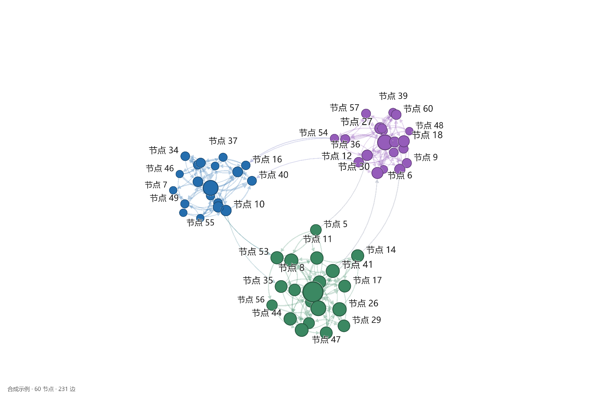
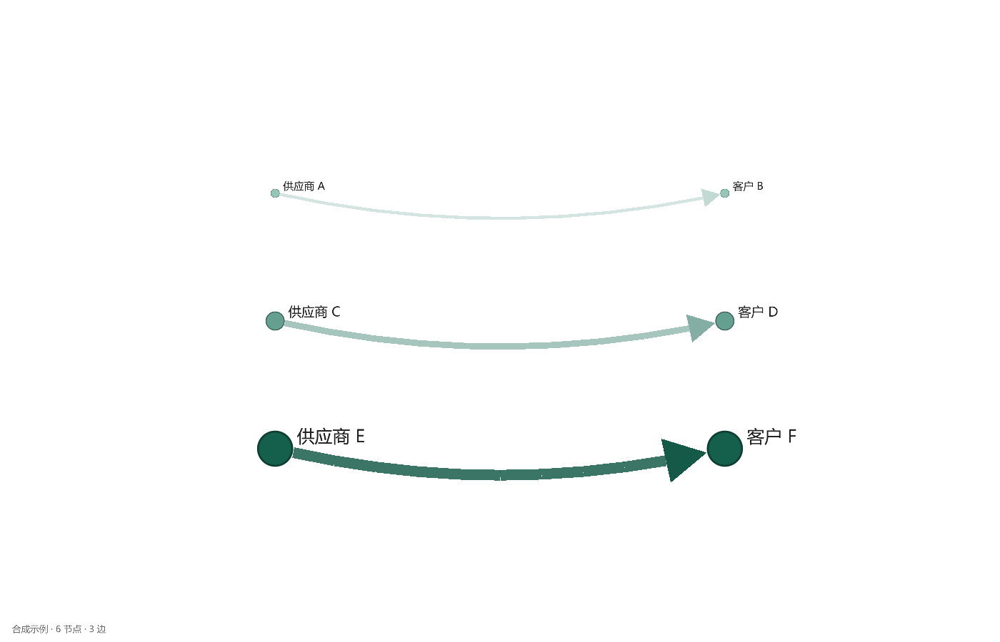

# Gephi 3D Explorer

**v0.1.12-alpha · Windows · Gephi 0.11.3 / 0.11.4**

[下载 v0.1.12-alpha 完整安装包](https://github.com/dxy624/Gephi-and-codex/releases/download/v0.1.12-alpha/gephi-3d-explorer-v0.1.12-alpha.zip) · [查看发行说明](https://github.com/dxy624/Gephi-and-codex/releases/tag/v0.1.12-alpha)

在 Gephi 内旋转、分层和探索三维网络，也可让 Codex 用中文控制同一个视图。此仓库包含 Gephi 插件、独立 MCP 服务和 `gephi-3d` Skill，三者配合使用。

**默认通过插件接口执行，不接管鼠标键盘。** 连接失败会报告原因；只有用户明确要求操作界面时，才允许使用电脑控制。图像检查使用插件导出，无需桌面截图或拖动验证。



**English:** An experimental dockable 3D network explorer for Gephi on Windows with a Codex skill and MCP tools. Open Gephi from its regular desktop shortcut, or choose the independent launcher. See the [English quick start](docs/QUICKSTART.en.md).

## 1. 安装前置软件

- Windows 版 [Gephi 0.11.4](https://github.com/gephi/gephi/releases/tag/v0.11.4) 或 [Gephi 0.11.3](https://github.com/gephi/gephi/releases/tag/v0.11.3)。
- [Python 3.12](https://www.python.org/downloads/windows/)；安装时包含 Python Launcher。
- 已安装 Codex。此插件本身不需要 OpenAI API Key；Codex 按其自身登录和使用规则运行。

普通使用优先使用 Gephi 自带 Java 17，无需另装 JDK 或 Maven。只有重新编译源码才需要 **JDK 17**。

下载后请先把整个 ZIP 解压到准备长期保留的位置。不要在压缩包内部启动；安装后移动目录需要重新建立 Python 环境并更新 MCP 路径。

## 2. 安装插件与连接

保存已打开的 Gephi 工程并正常退出桌面客户端。在解压目录中打开 PowerShell，预览安装：

```powershell
py -3.12 scripts/setup.py --install-skill --configure-codex --dry-run
```

确认后安装：

```powershell
py -3.12 scripts/setup.py --install-skill --configure-codex
```

默认安装到桌面 Gephi 的用户目录 `%APPDATA%\gephi\0.11`。安装会建立本项目的 `.venv` 并安装依赖。两个显式选项分别安装 Skill 和配置 Codex。修改 Codex 配置前会备份到其用户目录下的 `backups`。

Gephi 不在默认位置时指定安装目录；目录应包含 `gephi` 和 `platform` 子目录：

```powershell
py -3.12 scripts/setup.py --gephi "D:\Apps\Gephi-0.11.4" --install-skill --configure-codex
```

也可设置 `GEPHI_HOME`。只安装桌面插件和运行依赖时，运行 `py -3.12 scripts/setup.py`。

安装成功后重新打开 Codex。Skill 的安装与 MCP/Gephi 的安装是不同步骤；仅从 GitHub 安装 Skill 不能获得完整运行环境。[Codex 技能](https://developers.openai.com/codex/skills) · [MCP 配置](https://developers.openai.com/codex/mcp)

### 从旧发行版切换到桌面客户端

将新版解压到新目录。如果安装器提示 `gephi-3d` 已指向旧发行版，先加 `--dry-run` 预览下方命令，确认后执行。它会备份并替换这一个连接。

```powershell
py -3.12 scripts/setup.py --configure-codex --replace-gephi-connection
```

识别到上一发行包安装的桌面插件时，安装器会备份旧插件并升级。若安装器提示存在其他来源的模块，请在 Gephi 插件管理器里检查，可通过其中的「已下载」页安装新版 [NBM](dist/gephi-3d-explorer-0.1.12.nbm)。若此前编辑过同名 Skill，保留个人版本即可。安装后重开 Gephi 与 Codex。

## 3. 启动

双击桌面 **Gephi** 图标，或从 Windows 开始菜单打开 Gephi。保持客户端打开，再向 Codex 下达绘图指令。桌面客户端的插件接口默认使用本机端口 `8183`。

如面板未显示，进入 **窗口 → 3D Explorer · 三维探索**。

打开网络后，可在右侧「外观」勾选**有向边箭头**，单独调整**箭头大小**和**线条粗细**。边权重使强连接的箭头更大、连线更粗。普通视图与地理地图都适用，导出反映当前设置，保存 `.gephi` 后可恢复。



| 鼠标 | 行为 |
|---|---|
| 左键拖动 | 旋转 |
| 右键或中键拖动 | 平移 |
| 滚轮 | 缩放 |
| 点击 / Ctrl 点击 | 单选 / 增减选区 |
| 双击节点 | 聚焦 |
| Shift 拖动 | 按屏幕矩形框选；Ctrl 可追加 |
| 悬停 | 查看节点简要属性 |

### 可选独立模式

如希望 Codex 连接独立 Gephi，运行以下命令，再双击 **Start-Gephi-3D.cmd** 并重新打开 Codex。已有桌面连接时，确认要切换后加 `--replace-gephi-connection`。

```powershell
py -3.12 scripts/setup.py --mode isolated --install-skill --configure-codex
```

独立模式默认使用本机端口 `8184`，运行数据和日志位于 `%LOCALAPPDATA%\Gephi3DExplorer`。独立入口可以随时打开。Codex 控制安装时选定的实例。

## 4. 用中文绘图

在 Codex 中输入：

> 使用 gephi-3d，生成一个 60 节点、3 社区的合成网络，按社区配色并运行三维布局。找到节点 12，聚焦它，高亮两阶邻居；把社区分层，保存观察视角。

> 打开当前工作区的有向边箭头，把箭头大小调到 1.8 倍，线宽调到 2 倍。

也可以自行点击面板的“生成示例网络”和“三维布局”。已有数据可对 Codex 说：

> 使用 gephi-3d，通过插件接口把指定绝对路径的 GEXF 导入新工作区，保留已有图；按 level 属性分层，运行三维布局并保存视角。不要使用电脑控制。

`gephi3d_import_graph` 直接导入静态 GEXF，保留中文 ID、属性、方向、权重、颜色和已有 XYZ；未提供坐标的节点获得初始三维位置。CSV/XLSX 先转换成 GEXF。[示例与数据格式](examples/README.md)

导入上限为 20 MB、10000 节点、100000 边；不支持动态图或嵌套 GEXF 节点，行政层级可使用普通节点、parent 属性和有向边表示。错误文件不会覆盖已有图。

升级后重新打开所选模式的 Gephi 和 Codex，即可加载 38 个 MCP 工具。

要一次完成导入、布局、配色和展示，可让 Codex 调用 `gephi3d_auto_draw`。它能直接读带节点表和连接表的 XLSX，或读静态 GEXF；按社区配色，用权重控制线宽，有向边才显示箭头。没有数据时，可以明确要求生成合成例子。

供应链地理图使用 `gephi3d_supply_chain_map`。提供一份 GEXF、CSV 或 Stata `.dta` 关系数据，一个本地 GeoJSON 底图，以及与底图坐标基准一致的城市中心坐标表。按城市代码匹配企业，指定链主编号后，地图上会放大链主社区、加粗社区内连线。地图**默认关闭**，在当前工作区右侧勾选「地理地图」即可手动切换；关闭会恢复普通视图。发行包中的预览是合成网络。底图和真实企业数据由用户提供。[字段与示例](examples/README.md)

## 5. 筛选、分层和字段配色

- **筛选**：按企业代码或名称、城市、社区、最小度数或边权缩小范围。要看某家企业的上下游，先用三维面板顶部的「查找」选中它，再用「只看一阶邻居」或「只看两阶邻居」。查看完整邻居时，将企业、城市、社区和边权条件留空，最小度数设为 0。
- **层开关**：选择分层字段，逐层勾选显示。隐藏层同时隐藏该层企业和相连的边，SVG 和 PNG 导出沿用这套设置。
- **字段配色**：按城市、行业、社区等已有字段做类别配色，也可按连接数等数值字段做渐变。选「使用外观预设」可恢复预设配色。
- **论文图例**：在 SVG 导出窗口点「编辑图例」。可预览符号、逐项隐藏或改名，再选图例放在图上方或下方。

这些设置随 `.gephi` 工程保存。Codex 可通过 `gephi3d_filter`、`gephi3d_layer_visibility`、`gephi3d_node_colors` 和 `gephi3d_paper_legend` 设置。

## 6. 查看上下游、出图预设和年份对比

在三维面板选中企业，点「查看上下游」，选择供应商、客户或双向，以及一阶或两阶。结果会显示相关企业数量、已有地图的定位覆盖情况和挡住结果的筛选项。需要时可在同一个窗口解除其中一项限制。

「出图预设」提供「链主关系图」和「地理供应链图」。也可以保存当前配色、线宽、标签、地图设置、图例和视角，供同一个工程里的其他企业复用。SVG 内嵌中心企业、方向、筛选条件、年份和视角等信息。

带边年份的工程可点「年份 / 对比」，选择一个年份或再选一个基准年。绿色表示仅所选年份有记录，红色表示仅基准年有记录。已合并年份的工程需要重导入原始关系表。年度关系表中的城市位置以每家企业最近一条非空城市代码为准，各年共用。详见 [数据字段](examples/README.md)。

对应的 Codex 工具为 `gephi3d_supply_scope`、`gephi3d_clear_scope_block`、`gephi3d_figure_preset` 和 `gephi3d_years`。

## 7. 保存与导出

向 Codex 明确指定**可写文件夹的完整路径**。保存 `.gephi` 以保留网络、三维坐标、相机和书签；导出默认 6000×4000 PNG，也可生成嵌入该图和中文说明的 PDF。导出附带场景 JSON。

需要可编辑的论文图时，在三维面板选中企业或节点（按住 `Ctrl` 多选），点击**导出论文图（SVG）**。可按毫米预览整页，调整节点、线宽、箭头和字号，标注重点企业，或导出共用视角与线宽标尺的双年份组图。 图注默认关闭，可按需开启。导出会放大选中节点、优先安排标签、加深直接关系并淡化背景，图例只列出当前画面需要解释的项目。如果已有最短路径高亮，导出优先突出该路径。节点、连线、箭头和文字可分别编辑。Codex 可调用 `gephi3d_export_paper`。

在导出预览左侧的「论文样式」可切换论文浅色或黑白打印，设置字体、页边距和强调色。黑白年度叠加对比用虚线标识基准年独有的边，图例使用相同线型。

地图视图只画两端都能定位的关系，图注会注明重点关系的定位缺失情况。关闭「地理地图」后可按网络结构查看这些关系。SVG 输出为当前三维视图的二维投影，可为重点关系重新取景。

现有文件不会被覆盖，请使用新文件名。目录权限失败时应选择可写位置或自行授权；管理员安装目录不适合作为结果目录。

三维坐标与 Gephi 原来的二维坐标分开保存。原有 Gephi-AI 若连接另一个实例，不能用它保存或修改当前三维实例中的图。

## 已知限制与验证

筛选与字段配色以工程内已有的节点字段为准。论文图例支持逐项显示、改名和上下位置，多类别图例会合并为简要说明。框选暂不显示拖拽矩形，标签数量有限。无时间动画或三轴拖拽编辑，JSON 快照暂不能导回。

本次桌面安装针对 Windows，先前的三维模块在 Gephi 0.11.3 上完成验收。当前发布的实测版本和项目见 [验收说明](docs/VALIDATION.md)。

## 开发与发布

[开发、测试与构建](docs/DEVELOPMENT.md) · [版本说明](CHANGELOG.md) · [第三方组件](THIRD_PARTY_NOTICES.md) · [MIT 许可证](LICENSE)

仓库不附带 Gephi、JDK、Python 安装程序或任何本机访问 token。`release-files.json` 是发布文件清单，打包脚本只读取清单内文件。
