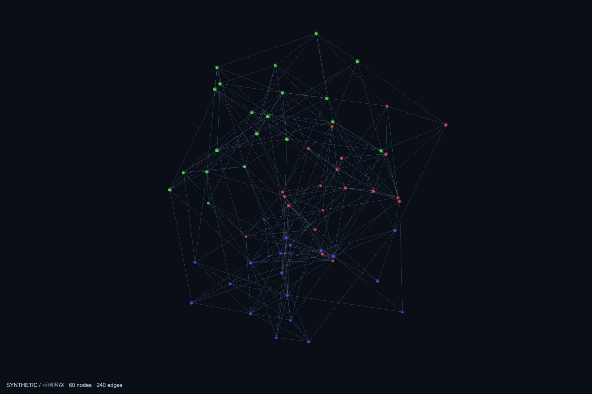

# Gephi 3D Explorer

**v0.1.0-alpha · Windows · Gephi 0.11.3**

在 Gephi 内旋转、分层和探索三维网络，也可让 Codex 用中文控制同一个视图。此仓库包含 Gephi 插件、独立 MCP 服务和 `gephi-3d` Skill，三者配合使用。



**English:** An experimental dockable 3D network explorer for Gephi 0.11.3 on Windows, controlled through mouse interaction or Codex MCP tools. Includes a Gephi module, a Python MCP bridge and an Agent Skill. This is an Alpha release; the example network is synthetic. See [English quick start](docs/QUICKSTART.en.md).

## 1. 安装前置软件

- [Gephi 0.11.3](https://github.com/gephi/gephi/releases/tag/v0.11.3) Windows 版。
- [Python 3.12](https://www.python.org/downloads/windows/)；安装时包含 Python Launcher。
- 已安装 Codex。此插件本身不需要 OpenAI API Key；Codex 按其自身登录和使用规则运行。

普通使用优先使用 Gephi 自带 Java 17，无需另装 JDK 或 Maven。只有重新编译源码才需要 **JDK 17**。

下载后请先把整个 ZIP 解压到准备长期保留的位置。不要在压缩包内部启动；安装后移动目录需要重新建立 Python 环境并更新 MCP 路径。

## 2. 安装插件与连接

在解压目录中打开 PowerShell，先预览：

```powershell
py -3.12 scripts/setup.py --install-skill --configure-codex --dry-run
```

确认后安装：

```powershell
py -3.12 scripts/setup.py --install-skill --configure-codex
```

安装会建立本项目的 `.venv`、安装依赖、安装个人技能并新增 `gephi-3d` MCP 配置。已有同名但内容不同的技能或连接会报告冲突，不会直接覆盖。修改配置前会备份到 Codex 用户目录的 `backups` 中，其他配置保留。

Gephi 不在默认位置时指定安装目录；目录应包含 `gephi` 和 `platform` 子目录：

```powershell
py -3.12 scripts/setup.py --gephi "D:\Apps\Gephi-0.11.3" --install-skill --configure-codex
```

也可设置 `GEPHI_HOME`。只准备运行环境、不修改个人 Codex：运行不带 `--install-skill --configure-codex` 的安装命令。

安装成功后重新打开 Codex。Skill 的安装与 MCP/Gephi 的安装是不同步骤；仅从 GitHub 安装 Skill 不能获得完整运行环境。[Codex 技能](https://developers.openai.com/codex/skills) · [MCP 配置](https://developers.openai.com/codex/mcp)

## 3. 启动

双击根目录 **Start-Gephi-3D.cmd**。启动程序会从附带的 [NBM](dist/gephi-3d-explorer-0.1.0.nbm) 中安装本模块到独立配置，并打开真正的 Gephi。原来的 Gephi 配置不变。

默认本地服务为 `127.0.0.1:8184`，运行数据和日志在 `%LOCALAPPDATA%\Gephi3DExplorer`。同一实例已运行时复用其窗口；端口被其他实例占用时报告冲突，不关闭其他进程。正常关闭 Gephi 窗口即可退出。

如面板未显示，进入 **窗口 → 3D Explorer · 三维探索**。

| 鼠标 | 行为 |
|---|---|
| 左键拖动 | 旋转 |
| 右键或中键拖动 | 平移 |
| 滚轮 | 缩放 |
| 点击 / Ctrl 点击 | 单选 / 增减选区 |
| 双击节点 | 聚焦 |
| Shift 拖动 | 按屏幕矩形框选；Ctrl 可追加 |
| 悬停 | 查看节点简要属性 |

## 4. 用中文绘图

在 Codex 中输入：

> 使用 gephi-3d，生成一个 60 节点、3 社区的合成网络，按社区配色并运行三维布局。找到节点 12，聚焦它，高亮两阶邻居；把社区分层，保存观察视角。

也可以直接点击面板的“生成示例网络”和“三维布局”。已有 GEXF 使用 Gephi 菜单导入，随后点击“读取当前图”。[示例与数据格式](examples/README.md)

## 5. 保存与导出

向 Codex 明确指定**可写文件夹的完整路径**。保存 `.gephi` 以保留网络、三维坐标、相机和书签；导出默认 6000×4000 PNG，也可生成嵌入该图和中文说明的 PDF。导出附带场景 JSON。

现有文件不会被覆盖，请使用新文件名。目录权限失败时应选择可写位置或自行授权；管理员安装目录不适合作为结果目录。

三维坐标与 Gephi 原来的二维坐标分开保存。原有 Gephi-AI 若连接另一个实例，不能用它保存或修改当前三维实例中的图。

## 已知限制与验证

这是可运行原型，尚缺方向箭头、完整筛选面板、层隐藏控件、任意属性配色和完整论文图例编辑；当前以 MCP 完成筛选与部分样式调整。框选暂不显示拖拽矩形，标签数量有限。无时间动画、SVG 或三轴拖拽编辑，JSON 快照暂不能导回。

只验证 Windows＋Gephi 0.11.3。9,000 节点 / 36,000 边曾在 Intel 集成显卡、1920×1080 短时离屏旋转中约为 62 FPS；这不是持续交互性能承诺，也未验证独立显卡。保存恢复、布局取消、数据转换和工具调用的记录见 [验收说明](docs/VALIDATION.md)。

## 开发与发布

[开发、测试与构建](docs/DEVELOPMENT.md) · [版本说明](CHANGELOG.md) · [第三方组件](THIRD_PARTY_NOTICES.md) · [MIT 许可证](LICENSE)

仓库不附带 Gephi、JDK、Python 安装程序或任何本机访问 token。`release-files.json` 是发布文件清单，打包脚本只读取清单内文件。
